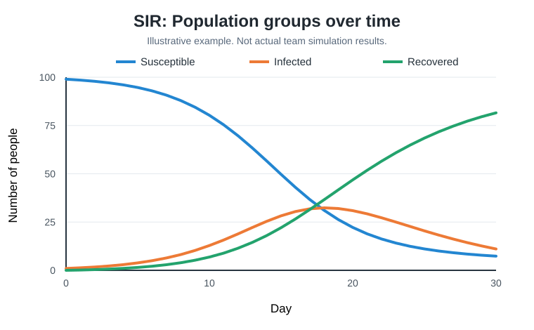
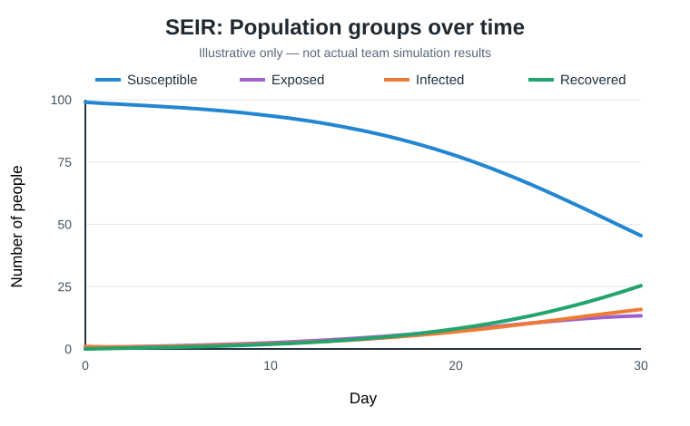

# Week 1: Introduction to SIR and SEIR

During Week 1, we will learn two disease models, practice Python, and build simple simulations together. Our six member team will choose responsibilities at our meeting. The example values are teaching assumptions, not medical estimates.

## What are SIR and SEIR?

SIR divides 100 people into Susceptible (S), Infected (I), and Recovered (R). Starting values:

```math
\begin{aligned}
S &= 99 \\
I &= 1 \\
R &= 0
\end{aligned}
```

**SIR flow:**


SEIR adds Exposed (E), a group infected but not yet infectious in our simplified model. **SEIR flow:**


SEIR starts at:

```math
\begin{aligned}
S &= 99 \\
E &= 0 \\
I &= 1 \\
R &= 0
\end{aligned}
```

In SIR:

```math
S + I + R = 100
```

In SEIR:

```math
S + E + I + R = 100
```

We assume no births, deaths, or reinfections. The exposed stage does not necessarily equal the real disease incubation period.

## Worked Python example

Variables hold numbers. Run this cell to check the starting population.

```python
population = 100
S = 99
I = 1
R = 0
print('Total:', S + I + R)
print('Matches population:', S + I + R == population)
```

**Expected:** Total: 100 and Matches population: True.

**Practice:** Try 200 people with 5 infected and none recovered. Calculate how many are susceptible. Hint: subtract infected and recovered from the total.

```python
# YOUR CODE GOES HERE
population = 200
I = 5
R = 0
# Calculate S and print the total
```

## How a day changes

In the simple SIR model, beta controls transmission and gamma controls recovery. For practice:

```math
\begin{aligned}
\beta &= 0.30 \\
\gamma &= 0.10
\end{aligned}
```

These are assumptions, not values for a particular disease.

New infections:

```math
\text{New infections} = \frac{\beta S I}{\text{population}}
```

New recoveries:

```math
\text{New recoveries} = \gamma I
```

Calculate both from the old values before updating S, I and R. S loses new infections, I gains new infections and loses recoveries, and R gains recoveries. Decimal results are expected quantities in this mathematical model, not fractions of real people.

```python
# WORKED EXAMPLE: one day
S, I, R = 99.0, 1.0, 0.0
beta, gamma = 0.30, 0.10
new_infections = beta * S * I / 100
new_recoveries = gamma * I
S = S - new_infections
I = I + new_infections - new_recoveries
R = R + new_recoveries
print(round(S,3), round(I,3), round(R,3))
```

## What changes for SEIR?

SEIR adds sigma, which controls how quickly exposed people move to the infectious group. For practice, we use:

```math
\sigma = 0.25\ \text{per day}
```

Daily changes are:

From S to E:

```math
\text{New exposures} = \frac{\beta S I}{\text{population}}
```

From E to I:

```math
\text{New infectious cases} = \sigma E
```

From I to R:

```math
\text{New recoveries} = \gamma I
```

Hint: updated E equals previous E plus new exposures minus people moving into I. Compute all three changes before updating the four groups.

## Our six responsibilities

We have five teammates plus me. We'll decide who takes each role at the meeting.

| Person | Task | Deliverable |
| :--- | :--- | :--- |
| Teammate 1 | Explain SIR, SEIR, and assumptions | Short Markdown explanation |
| Teammate 2 | Write a 30 day SIR simulation | SIR values saved for every day |
| Teammate 3 | Write a 30 day SEIR simulation | SEIR values saved for every day |
| Teammate 4 | Plot both models | Two labeled line charts |
| Teammate 5 | Test both models | Test notebook and notes |
| Me, Project Lead | Coordinate, review, interpret, and integrate | One approved final notebook and findings |

Teammates 2 and 3 should share their daily values with Teammates 4 and 5.

## Teammate 1: Concept explanation

Explain what S, E, I and R mean, why population stays constant, and two assumptions that make the models simpler than real disease outbreaks.

**Use this source from our [Research Sources](../research/README.md):**

[CDC Yellow Book: Influenza](https://www.cdc.gov/yellow-book/hcp/travel-associated-infections-diseases/influenza.html)

Read about the incubation period and when influenza can spread. In your own words, explain one useful fact from the source and how it connects to SIR or SEIR. Remember that the time before symptoms does not always match the time before someone becomes infectious.

Our beta, gamma, and sigma values are practice assumptions, not numbers taken from the CDC page.

**YOUR EXPLANATION GOES HERE.**

## Teammate 2: SIR model

Start with 100 people:

```math
\begin{aligned}
S &= 99 \\
I &= 1 \\
R &= 0
\end{aligned}
```

Repeat the one day formulas for 30 days and save daily values in lists.

Hints: `for day in range(1, 31):` repeats code. Use `.append(value)` to save daily values. Save day 0 first. Calculate infections and recoveries before updating the groups.

```python
# YOUR CODE GOES HERE: SIR simulation
# Use a for loop for 30 days
# Save day, S, I, and R values
```

## Teammate 3: SEIR model

Start with:

```math
\begin{aligned}
S &= 99 \\
E &= 0 \\
I &= 1 \\
R &= 0
\end{aligned}
```

Use these practice parameters:

```math
\begin{aligned}
\beta &= 0.30 \\
\sigma &= 0.25 \\
\gamma &= 0.10
\end{aligned}
```

Run the model for 30 days and save all four groups.

Hint: compute new exposures, new infectious cases, and new recoveries from the previous day's values first. Then update S, E, I, R.

```python
# YOUR CODE GOES HERE: SEIR simulation
# Use four groups and save daily values
```

## Teammate 4: Graphs

### Example chart layouts

These are **illustrations, not real results**. Your curves may look different. Use the actual day and infected values shared by Teammates 2 and 3.

**SIR chart**



**SEIR chart**



Ask Teammates 2 and 3 for their saved daily results. You do not need to write the simulations yourself.

1. Make one line chart showing **infected people over time** for SIR.
2. Make another line chart showing **infected people over time** for SEIR.
3. Label the horizontal axis **Day** and the vertical axis **Infected**, and give each chart a title.

**Hint:** Start with `import matplotlib.pyplot as plt`. Use `plt.plot(days, infected_values)` to draw the line, `plt.xlabel()` and `plt.ylabel()` for the axes, and `plt.show()` to display it. Ask for the lists of days and infected values if you do not have them.

```python
# YOUR CODE GOES HERE: SIR and SEIR charts
```

## Teammate 5: Testing

Ask Teammates 2 and 3 for their saved daily results. You do not need to write the simulations yourself.

Start with two checks for **both models**:

1. The total population stays at 100 each day.
2. No group has a negative value.

For SIR, check:

```math
S + I + R = 100
```

For SEIR, check:

```math
S + E + I + R = 100
```

**Hint:** `abs(total - 100) < 0.000001` allows small decimal rounding differences. If a check fails, write down the day and the problem. If you have time, also check that S does not increase and R does not decrease.

```python
# YOUR CODE GOES HERE: checks for SIR and SEIR
```

## Explanation and submission

### Written explanation

After finishing your assigned part, explain what you did and how it works. This helps us understand the project instead of just collecting code.

Write about **150 to 250 words**, using your own words. Keep it simple. Answer the four questions for everyone, then the questions for your role below.

### Questions for everyone

1. What part of Week 1 did I work on?
2. What steps did I take to complete it?
3. How does my part work, and why do we need it for our simulation?
4. What did I learn, check, or find difficult?

### Teammate 1: SIR and SEIR concepts

1. What does each letter in SIR and SEIR mean?
2. Why does SEIR have an Exposed group?
3. What assumptions are we making about our population?

### Teammate 2: SIR simulation

1. What do beta and gamma do in our model?
2. How does your code update the three groups each day?
3. Why did you use a loop and save the daily values?

### Teammate 3: SEIR simulation

1. How is your SEIR code different from the SIR code?
2. What does sigma represent?
3. How does the Exposed group change over time?

### Teammate 4: Charts

1. What does each line on your SIR and SEIR charts mean?
2. What do the horizontal and vertical axes show?
3. What differences do you notice between the two charts?

### Teammate 5: Testing

1. How did you check that the population stays at 100?
2. How did you check for negative values or calculation errors?
3. Why do we need to test the results before using the graphs?

### Where to submit

**Written explanation:** Follow the [Submission Guide](../SUBMISSION_GUIDE.md) to save and submit your explanation.

**Code, charts, and testing:** Follow the same [Submission Guide](../SUBMISSION_GUIDE.md) to submit your files and open a pull request.
